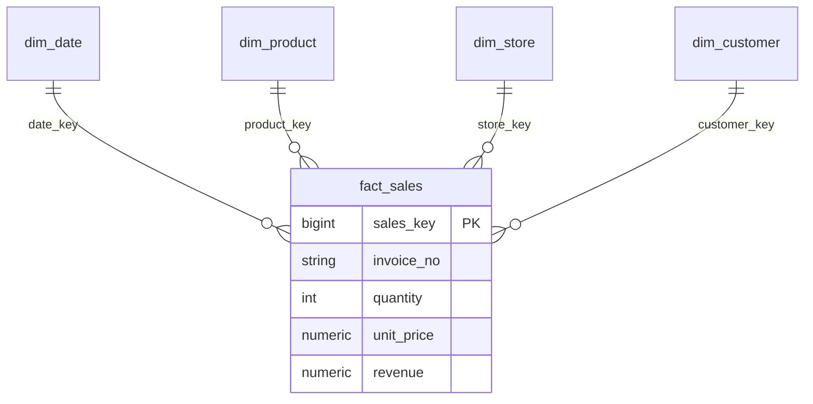

# Retail Sales Data Warehouse with OLAP (PostgreSQL + Flask)

A retail data warehouse with a star schema, a Pandas ETL pipeline, OLAP operations (roll-up, drill-down, slice, dice, cube) and an interactive dashboard. Built for the Techn Global project brief.

**Stack:** PostgreSQL, Python (Pandas, SQLAlchemy), Flask, Chart.js, pytest.

Full project report: [docs/Project_Report.docx](docs/Project_Report.docx)

## Star schema

## Dashboard screenshots
Add your screenshots to `docs/screenshots/` and link them here, for example ``.

Techn Global project: star-schema data warehouse, ETL, OLAP operations, SQL insights, dashboard, tests.

## Run in PyCharm
0. Prerequisites: Python 3.10+ and PostgreSQL.
1. Create the database: `CREATE DATABASE retail_dw;` (pgAdmin or `psql -U postgres`).
2. Open this folder in PyCharm (File > Open). Create a venv when prompted (Python 3.10+).
3. Terminal: `pip install -r requirements.txt`
4. Copy `.env.example` to `.env` and put your PostgreSQL password in `DATABASE_URL`.
5. Load the warehouse: `python etl/etl.py`
   - Without a file it generates a ~60k-row sample (Kaggle `carrie1/ecommerce-data` format).
   - For the real dataset: download `data.csv` from Kaggle and run `python etl/etl.py path/to/data.csv`.
6. Start the app: `python app.py`, then open http://127.0.0.1:5000
7. Test: `pytest -v`

## Mapping to the 10 guidance points
| # | Point | Where |
|---|-------|-------|
| 1 | Objective: OLAP retail sales warehouse | this README |
| 2 | Facts and dimensions | fact: sales (qty, revenue); dims: time, product, store, customer |
| 3 | Star schema | `sql/schema.sql` |
| 4 | ETL (Pandas) | `etl/etl.py` (cleans nulls, cancellations, duplicates; builds keys) |
| 5 | OLAP cube | `GROUP BY ROLLUP/CUBE` in `sql/olap_queries.sql`, `/api/olap` |
| 6 | Roll-up, drill-down, slice, dice | OLAP explorer + filters in the dashboard |
| 7 | SQL business insights | `sql/olap_queries.sql` (top products, seasonality, MoM growth) |
| 8 | Dashboards | `templates/index.html`, `static/` (Chart.js) |
| 9 | Testing | `tests/test_warehouse.py` (FK integrity, revenue accuracy, rollup total, speed) |
| 10 | Documentation | this README + code comments |

## Schema
`fact_sales(date_key, product_key, store_key, customer_key, quantity, unit_price, revenue)`
joined to `dim_date`, `dim_product` (category derived from description keywords), `dim_store` (one store per country), `dim_customer`.

## API
`/api/filters`, `/api/kpis`, `/api/olap?group=year,quarter&rollup=1`, `/api/top-products`, `/api/seasonal`, `/api/top-customers`.
All accept `year`, `quarter`, `month`, `category`, `country` (comma-separated values = dice).
